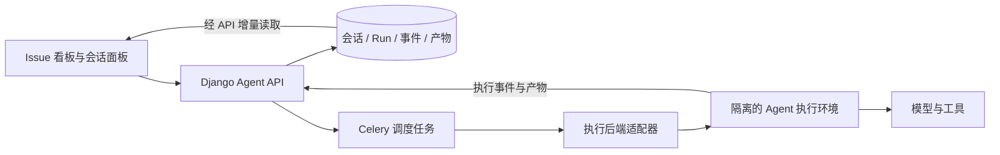

# AgentMatrix

基于 Issue 看板的 Agent 工作台：以任务卡片承载目标，以 Agent Session 持续推进工作，通过可组合的执行与迭代策略完成交付。

> 当前状态：基于 Plane 的项目管理基础，处于 Agent 能力的规划阶段。本文中的 Agent 功能、模型、接口和里程碑均为拟定方案，尚未实现。
>
> 原版 Plane README 已完整保存在 [README.plane.md](./README.plane.md)，可查看上游介绍、安装方式与社区信息。

## 项目目标

让用户在看板上组织、启动、观察和干预 Agent 的工作，把需求、执行过程和结果保留在同一张 Issue 卡片中。

期望的基础体验：

1. 创建 Issue，填写目标、背景资料和验收条件。
2. 在卡片中启动 Agent Session，由 Agent 获取上下文并执行任务。
3. 查看对话、工具调用、执行状态和产物，按需补充指令。
4. 对结果进行验收；需要修改时，在原有上下文中继续执行。
5. 后续通过子任务、依赖关系和策略模板，组合多个 Agent 的工作。

首个版本优先服务于单个用户手动发起和验收任务的场景，再逐步扩展团队协作与自动编排。看板中的 Issue 指本系统的工作项，接入 GitHub Issues 属于后续集成能力。

## 当前已有的基础

| 能力 | 现有实现 | 后续用途 |
| --- | --- | --- |
| 工作空间与项目 | Workspace、Project、成员和角色权限 | 组织任务，限定数据访问范围 |
| Issue 管理 | 描述、状态、优先级、负责人、标签、日期、附件等 | 承载任务目标、输入与验收结果 |
| 多种视图 | 看板、列表、表格、日历、甘特图 | 观察执行、筛选任务与安排交付 |
| 看板交互 | 拖动排序、分组、泳道、快速创建与编辑 | 扩展为 Agent 调度和监控入口 |
| 任务关系 | 父子任务、阻塞关系、关联关系 | 表达任务拆解和执行依赖 |
| 任务组织 | Cycles、Modules、自定义 Views | 管理阶段目标、功能模块和关注范围 |
| 文档与协作 | Pages、富文本编辑、实时协同、评论、活动记录 | 保存背景资料、人机讨论与交付文档 |
| 对外连接 | REST API、Webhook、投递日志 | 连接执行器与外部系统 |
| 后台服务 | Celery worker、定时任务、数据库、消息队列、对象存储 | 支撑调度、持久化和文件产物 |

现有 AI Assistant 提供单次文本生成；现有 Session 是用户登录会话。Agent 会话、工具执行、运行恢复和多 Agent 编排需要新增。Cycles 表示项目迭代周期，不能直接承担 Agent 的重试或评审循环。

## 核心概念

界面上保持「一张 Issue 卡片，一个主 Agent Session」的体验，底层区分任务、会话与执行，便于支持重试、继续工作和未来的多 Agent 组合。

| 概念 | 职责 | 初期关系 |
| --- | --- | --- |
| Issue | 定义目标、背景、优先级、依赖与验收条件 | 一张任务卡片 |
| Agent Session | 保存围绕任务的持续对话、上下文与执行配置 | 每个 Issue 按需建立一个主会话 |
| Run | 表示一次实际执行，记录状态、输入快照、事件与结果 | 一个 Session 可以有多次 Run |
| Agent Profile | 描述执行后端、模型、角色指令和允许使用的工具 | 初期使用一套默认配置 |
| Artifact | 保存执行产物，如文档、文件、补丁、提交或链接 | 关联产生它的 Run |
| Strategy | 规定执行步骤、角色交接、循环和停止条件 | 首版采用手动发起、人工验收 |

首次启动时创建主会话；后续用户补充指令，在同一会话内发起新的 Run。初期同一会话只允许一个活动 Run。未来再扩展会话分叉、候选方案和专门负责评审的会话。

任务状态与运行状态分别维护：Issue 可以仍处于「进行中」，对应 Run 已经成功或失败。Run 成功仅表示本次执行完成，Issue 是否完成取决于验收。首次启动可按规则将未开始的 Issue 推进为进行中；失败或取消保留任务阶段，由用户决定后续操作。

拟定的首版 Run 状态为 `queued → running → succeeded / failed / cancelled`。后续引入等待用户、等待授权等状态；暂停和原地恢复仅在执行后端明确支持时开放。

## 实现思路

保留现有项目管理与协作体系，在 Django API 内增加 Agent 业务模块，通过独立执行进程承载实际工作。



- **业务层**负责权限、会话、执行请求、状态和验收，沿用 Workspace / Project 的访问边界。
- **调度层**负责投递、领取任务、取消请求、超时和异常收敛；长时间运行的 Agent 由执行环境承载。
- **执行适配器**提供启动执行、请求取消、查询状态和接收事件的统一接口；先接通一个真实后端，再增加其他后端。
- **执行环境**管理工作目录、工具和凭证范围；涉及代码或命令时使用隔离工作区与容器，具体实现按首个后端确定。
- **事件层**持久化消息、工具调用、状态变化和产物，使用 Run 内递增序号支持增量读取与断线补读。
- **交互层**首版采用增量轮询，后续按需要加入 SSE 或 WebSocket。已有文档协同服务继续承担文档同步。

执行事件与产物由执行服务通过业务层校验后落库。执行配置需要保存快照和版本，避免修改默认配置后无法解释历史结果。敏感凭证只保留引用，不写入消息、事件和配置快照。

## 基础实现计划

以下按可独立验收的里程碑推进；所有 Agent 项均未完成，当前不承诺固定工期。首个执行后端在 M0 确定，后续任务据此细化。

### M0：明确首个任务与执行协议

- [ ] 选择一个贯穿开发的示例任务，明确输入、可用工具、产物和人工验收标准。
- [ ] 确定首个执行后端及部署方式，验证它的工具调用、事件输出、取消和超时能力。
- [ ] 明确 Issue、Session、Run、事件和 Artifact 的字段、权限与状态转换。
- [ ] 约定启动、追加指令、取消、查询状态与读取增量事件的 API 契约。

**验收：** 示例任务能够通过选定后端真实执行并产生可检查的产物，能力边界和数据协议有明确记录。

### M1：建立可持久化的会话与执行记录

- [ ] 新增 Agent Session、消息、Run、事件、产物的模型、迁移和 API。
- [ ] 支持创建或获取 Issue 的主会话，保存用户指令与本次执行输入快照。
- [ ] 实现启动请求去重、Run 状态转换，以及同一会话的活动 Run 互斥。
- [ ] 支持按事件序号增量查询，校验所有读写的 Workspace / Project 权限。

**验收：** 会话和执行记录可通过 API 创建、查询并在服务重启后保留；重复启动不会生成重复执行，越权访问被拒绝。

### M2：接入真实 Agent 执行

- [ ] 用 Celery 投递调度任务，接入 M0 选定的执行后端。
- [ ] 将用户指令、Issue 输入和指定资料组织为本次执行上下文。
- [ ] 持久化模型输出、工具事件、产物和最终执行结果。
- [ ] 实现取消确认、执行超时、心跳或状态对账，收敛失联任务。
- [ ] 处理重复队列投递和迟到事件，禁止取消或失败后的旧事件覆盖终态。

**验收：** 可以从 Issue 启动真实任务并查询结果；取消、超时和进程异常均有可解释状态，无效旧任务不会继续回写当前结果。

### M3：打通看板内的人机工作闭环

- [ ] 在 Issue 详情和快速查看面板中增加会话入口。
- [ ] 展示用户消息、Agent 输出、工具调用、执行状态、错误和产物。
- [ ] 增加启动、追加指令和取消操作，在卡片上展示运行摘要。
- [ ] 通过增量读取更新执行过程；刷新页面后恢复历史和当前状态。
- [ ] 支持人工验收并完成 Issue；未通过时以新 Run 继续工作。

**验收：** 用户能完成「创建卡片 → 执行 → 查看产物 → 补充要求 → 再执行 → 验收」全过程。

**M0–M3 构成首个 MVP。** 它只包含单一执行后端、每张卡片一个主会话、显式启动和人工验收；拖动卡片仍遵循任务管理语义。自动触发、多 Agent 编排和策略编辑器安排在后续阶段。

### M4：补齐连续工作与运行治理

- [ ] 增加等待用户输入、工具授权和恢复执行的交互，区分继续会话与恢复底层进程。
- [ ] 实现失败后的显式重试，保留历史 Run，明确工具副作用和幂等边界。
- [ ] 增加并发限制、执行预算、耗时与可获取的模型用量记录。
- [ ] 支持上下文摘要、资料版本引用和运行配置追踪。

**验收：** 用户能理解并处理等待、失败和预算耗尽；重试不覆盖历史，系统不盲目重放有副作用的操作。

### M5：引入基础组合与迭代策略

- [ ] 先提供固定模板，如「实施 → 评审 → 修正」，限制最大轮数并定义退出条件。
- [ ] 基于 Issue 依赖实现串行调度，检查依赖环和前置任务验收结果。
- [ ] 基于子 Issue 实现受控并行、失败处理和结果汇总。
- [ ] 为策略实例保存版本、步骤状态、输入输出和人工干预记录。

**验收：** 一项多步骤任务可以按规则推进，失败时停止或进入明确分支，达到轮数或预算上限后停止并交还用户。

## 预计涉及的代码位置

以下新增目录与文件为建议位置，实际开发时按已有代码约定细化。

| 范围 | 位置 | 预计工作 |
| --- | --- | --- |
| Agent 数据 | `apps/api/plane/db/models/agent.py`（新增）、`apps/api/plane/db/migrations/` | 会话、消息、Run、事件和产物模型 |
| Agent API | `apps/api/plane/app/views/agent/`、`apps/api/plane/app/serializers/agent.py`、`apps/api/plane/app/urls/agent.py`（新增） | 会话、执行控制与增量事件接口 |
| 执行服务 | `apps/api/plane/agent/`、`apps/api/plane/bgtasks/agent_run_task.py`（新增） | 业务服务、适配器、执行调度与异常收敛 |
| API 接线 | `apps/api/plane/db/models/__init__.py`、`apps/api/plane/app/urls/__init__.py` | 注册模型与路由 |
| 共享类型与客户端 | `packages/types/src/agent/`、`packages/services/src/agent/`（新增） | 数据契约与 API 调用 |
| 前端状态与面板 | `apps/web/store/agent/`、`apps/web/components/agent/`（新增） | 会话状态、执行记录、消息和产物展示 |
| Issue 集成 | `apps/web/components/issues/issue-detail/`、`apps/web/components/issues/peek-overview/`、`apps/web/components/issues/issue-layouts/kanban/` | 会话入口与卡片运行摘要 |
| 部署与验证 | `docker-compose*.yml`、`apps/api/plane/tests/` | 执行服务配置、接口与生命周期测试 |

通用组件继续复用现有 UI 包；首版避免改写 Issue 主模型和看板布局逻辑，用关联模型增加 Agent 能力。

## 未来方向

| 方向 | 目标体验 | 前置基础 |
| --- | --- | --- |
| 多角色协作 | 规划、实施、测试、评审各自承担职责并交接结果 | 稳定会话、明确输入输出与角色权限 |
| 策略模板 | 为不同任务选择不同的执行和验收流程 | 可追踪的步骤、条件、预算与停止规则 |
| 任务依赖编排 | 前置任务验收后触发后续任务，并行处理独立子任务 | 依赖检查、并发控制与结果汇总 |
| 多方案与会话分叉 | 从同一目标探索不同方案，比较后选择结果 | 上下文快照、独立工作区和产物比较 |
| 多执行后端 | 按任务选择模型、Agent 框架或执行环境 | 统一适配器及后端能力声明 |
| 开发交付集成 | 关联仓库、分支、worktree、补丁、PR 和 CI 结果 | 隔离执行、凭证范围与交付验收机制 |
| 工具与知识扩展 | 按项目接入 MCP 工具、文档和外部业务数据 | 工具授权、检索与资料版本引用 |
| 看板自动化 | 显式规则把卡片状态变化转换为调度动作 | 事件去重、触发来源识别和循环防护 |
| 质量与成本评估 | 比较策略的成功率、返工率、耗时和成本 | 完整执行事件、验收记录与可比任务样本 |

长期希望实现：用户主要管理目标、优先级、依赖和验收，Agent 按可观察、可干预、有限制的策略持续推进工作。

## 验证原则

- 模型与接口：测试关联、权限、输入校验和状态转换。
- 调度与执行：测试重复启动、重复投递、取消竞争、超时、进程异常和迟到事件。
- 事件与前端：测试顺序、增量补读、页面刷新、追加指令和产物访问。
- 策略：测试依赖环、前置任务失败、并行汇总、最大轮数与预算耗尽。
- 每个里程碑用固定示例任务验收；模拟执行器用于测试，真实后端用于验证端到端能力。

## 开发与上游说明

分支协作约定：

- `dev`：主要开发与集成分支，后续开发任务直接在此推进，或通过任务分支合并到此。
- `main`：后续稳定发布分支，经过验证的阶段性成果由 `dev` 合入。

当前技术栈包括 React / TypeScript / React Router / Vite、MobX、Django / DRF、Celery、PostgreSQL、Redis / Valkey、RabbitMQ、Hocuspocus / Yjs 和对象存储。

常用命令：

```bash
pnpm dev
pnpm build
pnpm check
pnpm check:types
pnpm check:lint
```

开发规范参见 [AGENTS.md](./AGENTS.md)。环境初始化脚本为 [setup.sh](./setup.sh)，本地服务配置见 [docker-compose-local.yml](./docker-compose-local.yml)；初始化会写入环境文件，已有配置应先保留。Node 与 pnpm 要求以根目录 [package.json](./package.json) 为准。

后端测试方式参见 [测试运行说明](./apps/api/tests/RUNNING_TESTS.md) 和 [测试指南](./apps/api/plane/tests/TESTING_GUIDE.md)。新增执行服务后的部署步骤将在相应里程碑中补充，当前命令不会启动尚未实现的 Agent 工作流程。

本项目基于 [Plane](https://github.com/makeplane/plane) 演进，保留上游版权与来源说明，沿用 AGPL-3.0 许可证，详见 [LICENSE.txt](./LICENSE.txt)。完整的原版项目介绍见 [README.plane.md](./README.plane.md)。
