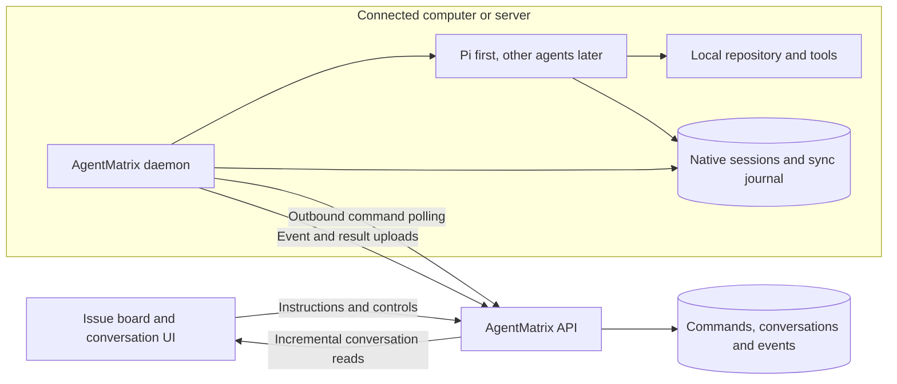

# AgentMatrix

An Issue-based workspace for agents running on your own computers and servers.

Connect a machine with the AgentMatrix daemon, choose a local workspace and agent, and run work from an Issue card. AgentMatrix keeps the conversation visible and persistent while the connected machine owns execution.

> **Status:** architecture and initial build roadmap. The repository currently provides the Plane-based project-management foundation. Machine pairing, the daemon, Pi integration, conversation synchronization, and the two-container environment described below are planned.
>
> The original Plane README is preserved unchanged in [README.plane.md](./README.plane.md).

## Product direction

Each Issue is a task with a persistent agent conversation. Users describe the goal, select a connected machine and local workspace, send instructions, inspect tool activity and results, and continue the same conversation until the work passes review.

The platform focuses on organizing and observing work. Agent processes, repositories, tools, native sessions, and model credentials stay on connected machines.

Local execution refers to where the agent and tools run. An agent may still call a cloud model using credentials configured on that machine.

## What already exists

The project builds on Plane:

| Existing foundation                                       | Role in AgentMatrix                           |
| --------------------------------------------------------- | --------------------------------------------- |
| Workspaces, projects, members, and permissions            | Organize tasks and control access             |
| Issues, descriptions, labels, priorities, and attachments | Define goals, inputs, and acceptance criteria |
| Kanban, list, spreadsheet, calendar, and Gantt views      | Organize and monitor work                     |
| Parent/child Issues and dependency relationships          | Foundation for later task composition         |
| Cycles, Modules, and saved Views                          | Group delivery goals and operational views    |
| Pages, rich-text editing, comments, and activity history  | Background material and collaboration         |
| REST APIs, webhooks, and persistent storage               | Integration and synchronization foundations   |

The existing AI Assistant is a single text-generation integration. Existing Session records represent user login sessions. Neither implements the local-agent workflow in this document.

## Architecture

AgentMatrix is the control and visibility layer. A small daemon installed on each connected machine supervises local agents and synchronizes their activity.



### Platform responsibilities

- Manage Issues, permissions, machine registration, and workspace bindings.
- Persist commands, user messages, normalized agent events, and selected artifacts.
- Show machine availability, conversations, tool activity, execution history, and results.
- Record human acceptance separately from execution success.
- Coordinate task dependencies and strategies in later versions.

### Daemon responsibilities

- Pair the machine, maintain its identity, and report availability and agent capabilities.
- Resolve registered workspace IDs to locally approved paths.
- Start, supervise, stop, and resume supported agent sessions.
- Keep provider credentials and native agent state on the machine.
- Journal commands and events locally, deduplicate deliveries, and synchronize after reconnecting.
- Translate each agent's protocol into versioned AgentMatrix commands and events.

The platform does not need agent installations, repository clones, shell access to machines, or model API keys for this workflow. Existing Plane infrastructure retains its current responsibilities; the new dispatch path can use durable PostgreSQL commands without requiring Celery to host or invoke agents.

## Connecting a machine

1. Install and start the daemon on a computer or server.
2. Open its short-lived pairing link or enter its pairing code in AgentMatrix.
3. Sign in and confirm the machine and owning workspace.
4. The daemon receives a revocable credential scoped to that machine.
5. Register local workspace directories and enable supported agents locally.
6. Select the machine, workspace, and agent when starting an Issue conversation.

The first version permits only the machine owner to dispatch work. Team-shared machines require a later explicit access-grant model.

The daemon initiates outbound connections. Users do not expose an inbound daemon port or configure port forwarding. Machine credentials are separate from general user API tokens; the server checks machine ownership, workspace access, and assignment for every command and event.

Workspace registration defines where a task starts. It is not a filesystem sandbox. The daemon uses locally configured executable paths and workspace mappings; platform requests cannot supply arbitrary executables or unregistered paths. Agent tool restrictions must be enforced by the local runtime or operating-system isolation.

## First agent: Pi

Pi is the initial integration because it provides a structured RPC interface and persistent native sessions. The daemon runs a pinned, tested Pi version as a subprocess and exchanges JSONL commands and events over stdin/stdout.

The adapter will:

- Create and reopen persistent Pi sessions in the selected local workspace.
- Send prompts and translate message, tool, usage, and lifecycle events.
- Distinguish command acceptance from execution completion.
- Inspect settled execution, errors, and abort results before assigning a final Run status.
- Handle cancellation and queued follow-up work explicitly.
- Declare supported capabilities so the UI only exposes available controls.

Use persistent sessions, not Pi's ephemeral `--no-session` mode. Pi's native session state is authoritative for continuing model context; replaying the visible platform transcript is not equivalent to restoring that state.

Pi runs with its launching process's permissions. The simulated machine container supplies an isolation boundary during development; real installations must document their local execution permissions.

Codex, Claude Code, and other agents will follow through separate adapters using their supported structured interfaces. Live attachment to an independently running terminal agent is outside the initial build.

References: [Pi](https://github.com/earendil-works/pi), [RPC](https://github.com/earendil-works/pi/blob/main/packages/coding-agent/docs/rpc.md), [sessions](https://github.com/earendil-works/pi/blob/main/packages/coding-agent/docs/sessions.md), and [events](https://github.com/earendil-works/pi/blob/main/packages/coding-agent/docs/json.md). Protocol behavior must be verified against the pinned implementation version.

## Task, conversation, and execution model

| Entity           | Purpose                                                                       |
| ---------------- | ----------------------------------------------------------------------------- |
| Machine          | Registered device, owner, credential, capabilities, and last contact          |
| MachineWorkspace | Machine-local workspace binding with an opaque platform ID                    |
| AgentSession     | Issue conversation bound to a machine, workspace, adapter, and native session |
| Run              | One execution attempt within that conversation                                |
| MachineCommand   | Durable instruction to start, continue, or cancel assigned work               |
| AgentEvent       | Ordered, deduplicated record of messages, tools, status, or artifacts         |
| Artifact         | Selected output or file associated with a Run                                 |

The initial experience is one primary AgentSession per Issue, with multiple Runs over time. Each session permits one active Run. Idle sessions can reopen their native state; continuing a session remains bound to its original machine and workspace.

Issue state, Run state, and machine connectivity are separate. A successful Run does not automatically complete the Issue. Losing contact with a machine makes execution uncertain; it does not establish failure or authorize running the task elsewhere.

## Persistence and synchronization

Two complementary stores preserve the workflow:

| On the connected machine                         | On the platform                                        |
| ------------------------------------------------ | ------------------------------------------------------ |
| Native agent session and context state           | Issue, Session, and Run metadata                       |
| Local workspace and repository                   | User messages and completed assistant messages         |
| Durable command receipts and execution ownership | Normalized tool and lifecycle events                   |
| Event journal and synchronization cursor         | Searchable conversation history and selected artifacts |

Provider credentials remain local. Conversation text and tool output explicitly synchronized by the daemon are stored on the platform and may include repository content. Artifact uploads are explicit; the repository is not automatically mirrored.

The first transport uses outbound HTTPS polling and batched event uploads. Browser updates use incremental API reads. WebSocket or SSE delivery can be added later without changing the durable command/event contract.

Required behavior:

- Commands have stable IDs and a durable local execution record before launch.
- Event batches have stable IDs and ordered sequence numbers; retries cannot duplicate visible messages.
- The server acknowledges events after committing them. The daemon retains unacknowledged events for replay.
- Streaming text is coalesced for upload; completed messages provide authoritative transcript content.
- Disconnects buffer events locally. Reconnection reconciles commands and execution ownership before accepting new work.
- Delivery and event ingestion use retryable, at-least-once semantics. Uncertain tool effects are not blindly repeated.
- Offline machines are shown as unreachable. Active work is not automatically migrated or redispatched.
- Cancellation remains requested until confirmed. Revocation blocks future platform access; it cannot guarantee immediate termination on an offline machine.
- A daemon crash may interrupt its child agent. Recovery reconciles native state and marks uncertain work for review instead of silently restarting it.

## Development environment: two containers

The initial build uses exactly two application-environment containers:

| Container       | Contents                                                                                                                                 | Persistent state                                                 |
| --------------- | ---------------------------------------------------------------------------------------------------------------------------------------- | ---------------------------------------------------------------- |
| `platform`      | AgentMatrix built from this checkout, frontend/API, and required database, cache, queue, and storage services under a process supervisor | Platform database and uploaded artifacts                         |
| `local-machine` | TypeScript daemon, pinned Pi, local tools, and a fixture Git repository                                                                  | Machine identity, native sessions, local journal, and repository |

The existing [AIO image](./deployments/aio/community/README.md) still requires external infrastructure and uses prebuilt service images. The two-container harness requires a development-specific platform image built from the current source, with supporting services bundled inside it.

Only the platform publishes a browser-accessible port. The machine initiates connections over the test network and has no published listener. Each container has independent volumes; they communicate through the daemon API, with no shared repository volume or database access from the machine.

The harness must support independent restarts and disconnection tests. Deterministic protocol tests use a simulated adapter; an end-to-end smoke test uses real Pi and locally supplied provider credentials. Credentials are supplied at runtime and excluded from images and committed files. Automated tests run from the host or inside these containers rather than adding a third runtime service.

This packaging is for development and integration tests. Production platform services may be deployed separately, and the daemon remains independently installable on real machines without Docker.

## Initial build roadmap

The detailed milestone checklist and definition of done are in the [initial build issue brief](./docs/initial-build-issue.md).

All Agent milestones below are planned. The initial build is the complete M0–M5 workflow, delivered through independently testable increments.

| Milestone                        | Deliverable                                                                                                       | Acceptance                                                                                                                                 |
| -------------------------------- | ----------------------------------------------------------------------------------------------------------------- | ------------------------------------------------------------------------------------------------------------------------------------------ |
| M0: Protocol and harness         | Versioned command/event contracts, a fixed fixture task, and the two-container environment                        | Current source boots; the simulated machine reaches the platform through its outbound API path                                             |
| M1: Machine connection           | Pairing, scoped credentials, revocation, heartbeat, workspace registration, and capability discovery              | The owner sees an online machine and approved workspace; expired pairing and unauthorized requests are rejected                            |
| M2: Local Pi execution           | Session/Run/command models, daemon supervisor, Pi adapter, and local command journal                              | An Issue instruction executes through real Pi in the machine container and produces a persistent native session and result                 |
| M3: Conversation experience      | Machine selector, Issue conversation panel, tool timeline, artifacts, follow-up, cancellation, and card summaries | Users complete multiple turns in the same native session; refresh preserves history; cancellation is visibly acknowledged                  |
| M4: Recovery and correctness     | Event replay, deduplication, restart reconciliation, stale-event protection, and offline states                   | Duplicate deliveries do not launch duplicate work; network loss preserves history; uncertain execution is never automatically redispatched |
| M5: Release the initial workflow | Independent daemon packaging, configuration/help, repeatable smoke tests, and setup/troubleshooting documentation | A documented install/pair/run/reconnect flow works with Pi; both containers retain their own state across restarts                         |

Completion requires a fixed task that changes a fixture repository and produces a reviewable artifact, followed by a second instruction in the same session. The platform must display its messages and tool activity and preserve the conversation through browser refresh and connection interruption.

### Initial scope

One owner, one selected machine per session, one registered workspace, one Pi adapter, one primary session per Issue, and one active Run per session. Users explicitly start work and accept results.

Multi-agent strategies, other adapters, automatic machine selection, cross-machine migration, terminal-session attachment, and automatic execution on card drag are later work. No daemon or harness startup commands are advertised as available until implemented.

## Expected code boundaries

These are proposed additions, not existing modules:

| Location                                                             | Responsibility                                                                                                           |
| -------------------------------------------------------------------- | ------------------------------------------------------------------------------------------------------------------------ |
| `apps/daemon/`                                                       | Installable TypeScript CLI/service, pairing, polling, process supervision, local persistence, and synchronization        |
| `packages/agent-protocol/`                                           | Versioned command/event schemas, validation, fixtures, and conformance examples; Python validates the same wire contract |
| `packages/agent-adapters/`                                           | Local adapter interface and Pi subprocess implementation                                                                 |
| `apps/api/plane/db/models/agent.py` and migrations                   | Machine, workspace binding, Session, Run, command, event, and artifact models                                            |
| `apps/api/plane/agent/`                                              | Platform command ownership, ingestion, reconciliation, and authorization services                                        |
| `apps/api/plane/app/views/agent/`, serializers, and URL registration | User and machine API endpoints with separate authentication                                                              |
| `packages/types/src/agent/` and `packages/services/src/agent/`       | Platform types and browser API clients                                                                                   |
| `apps/web/store/agent/` and `apps/web/components/agent/`             | Machines UI, conversation state, timeline, and execution controls                                                        |
| Existing Issue detail, peek, and Kanban components                   | Conversation entry points and execution summaries                                                                        |
| `deployments/development/` and a dedicated Compose file              | Two-container source-built environment, fixtures, health checks, and integration scenarios                               |

Keep adapters and process control on the machine. Reuse existing Issue, permissions, and UI foundations; agent records extend them through associations.

## Validation

The initial build must exercise:

- Pairing expiration/reuse, machine revocation, owner/workspace isolation, and registered-path validation.
- Command redelivery, concurrent starts, cancellation races, unexpected agent exits, and uncertain execution outcomes.
- Duplicate and out-of-order events, replay after acknowledgement loss, stale events, and large tool output.
- Native-session continuation, completed-message reconstruction, browser refresh, and independent container restarts.
- Network interruption while an agent continues locally, followed by complete synchronization without redispatch.
- A real Pi task that changes the fixture repository and a follow-up that uses its persistent conversation.

Adding a package includes its relevant tests and checks. No tests may require committed credentials or confuse a simulated adapter with proof of real Pi integration.

## Future direction

| Direction                      | Outcome                                                                     |
| ------------------------------ | --------------------------------------------------------------------------- |
| More local adapters            | Codex, Claude Code, and other agents behind capability-aware adapters       |
| Shared machines and routing    | Explicit team grants, capacity limits, and eligible-machine selection       |
| Strategy templates             | Plan, implement, review, and revise with budgets and stopping conditions    |
| Issue dependency orchestration | Serial and bounded parallel execution with result aggregation               |
| Branches and worktrees         | Independent local workspaces, patches, commits, PRs, and CI-linked review   |
| Session branching              | Compare alternative approaches while preserving native history              |
| Local tools and knowledge      | MCP, project documents, and business integrations configured on the machine |
| Faster delivery                | Optional outbound WebSocket connections and browser SSE                     |
| Quality and cost visibility    | Compare validated outcomes, rework, latency, and supported usage metrics    |

The long-term goal is to manage goals and acceptance on the board while connected machines carry out observable, interruptible work.

## Development and upstream

Development happens on `dev`, directly or through task branches merged into it. Validated milestones later merge into the stable `main` branch.

The existing platform uses React, TypeScript, React Router, Vite, MobX, Django/DRF, PostgreSQL, Celery, Redis/Valkey, RabbitMQ, Hocuspocus/Yjs, and object storage. The daemon is planned as a separate Node.js/TypeScript application.

Existing repository commands:

```bash
pnpm dev
pnpm build
pnpm check
pnpm check:types
pnpm check:lint
```

See [AGENTS.md](./AGENTS.md) for development conventions and [package.json](./package.json) for Node and pnpm requirements. Existing initialization uses [setup.sh](./setup.sh), which writes environment files; preserve existing configuration first. [docker-compose-local.yml](./docker-compose-local.yml) describes the current platform environment, not the planned two-container harness.

Backend verification guidance: [Running tests](./apps/api/tests/RUNNING_TESTS.md) and [Testing guide](./apps/api/plane/tests/TESTING_GUIDE.md).

AgentMatrix builds on [Plane](https://github.com/makeplane/plane), retains upstream attribution, and uses AGPL-3.0; see [LICENSE.txt](./LICENSE.txt). Pi is a separately licensed upstream dependency. The original project introduction remains in [README.plane.md](./README.plane.md).
